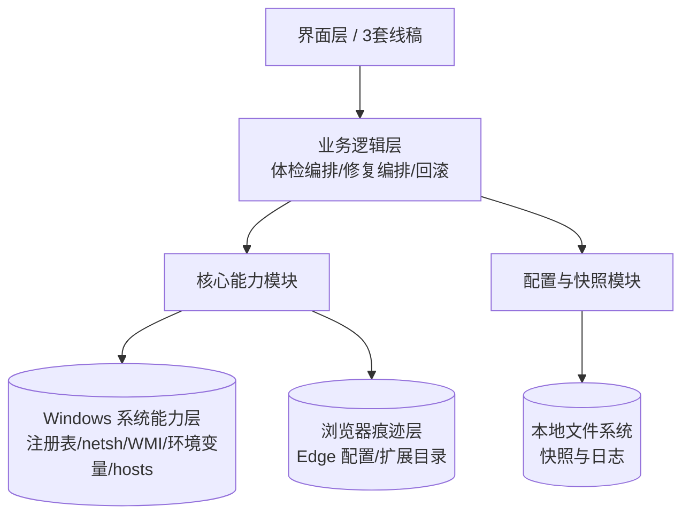
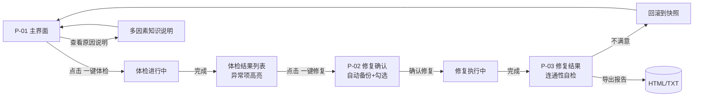

# NetFix 网络异常修复工具 需求文档（PRD）

| 项目 | 内容 |
| --- | --- |
| 版本 | v1.0 |
| 日期 | 2026-11-23 |
| 状态 | 待评审（Round 1 已出结论，Round 2 待确认分歧点后锁定） |
| 需求提出人 | 用户（市场部负责人，家用 Windows 机如遇断网场景的使用者） |
| 文档负责人 | 产品经理（AI 辅助） |
| 原型设计作者 | 微信号：TheSun_Also_Rises |
| 目标平台 | Windows 10 19045+ / Windows 11（本期仅 Windows，产出 `.exe`） |
| 适用读者 | 开发、测试、设计、需求提出人 |

> **一句话结论**：做一个 Windows 单文件绿色 exe「NetFix」，**先只读体检、再按需修复、全程可回滚**——默认一键恢复网络初始状态（关系统代理、刷 DNS、重置 Winsock/TCP/IP、清残留虚拟网卡 DNS），并专门覆盖"浏览器断网但其他软件正常"这类多通道故障；推荐用 C# / .NET WinForms 原生实现（加权 4.00），本机当前故障正是该系统代理残留问题的真实样本。

---

## 0. 假设与待确认项（必读）

| 编号 | 假设 / 待确认 | 来源 | 影响范围 | 确认状态 |
| --- | --- | --- | --- | --- |
| Q-01 | 目标运行平台为 Windows（因要求 `.exe`），最低支持 Win10 19045+ | 用户诉求 + 本机 Win11 26100 探测 | 架构、API、打包 | 已确认平台 / 最低版本待确认 |
| Q-02 | 开发机为家用 Windows 机（当前环境），但用户档案显示工作机为 MacBook Air M4；实际在哪台机器开发待确认 | 用户设备档案 | 工具链、交叉构建成本 | **待确认** |
| Q-03 | 本机未安装 .NET SDK / Visual Studio（仅探测到 .NET Host 运行时），是否已具备 C# 编译环境待确认 | 探测结果 | 方案 A 的开发成本 | **待确认** |
| Q-04 | "恢复所有网络初始状态"指：关闭非必要代理、DNS 恢复自动、Winsock/TCP/IP 重置，**不清空用户 saved Wi-Fi 密码、不改防火墙规则、不动 hosts 自定义条目** | 缺省假设（保守优先） | 修复范围与风险 | **待确认（关键）** |
| Q-05 | 工具完全离线运行、不上传任何诊断数据 | 缺省假设（隐私优先） | 合规、网络依赖 | 已按假设设计 |
| Q-06 | 需要代码签名证书以过 SmartScreen（未签名 exe 会触发警告） | 平台常识 | 分发成本 | **待确认** |
| Q-07 | 用户接受的交付物是"可落地设计蓝图（PRD+线稿+icon）"，确认后再进入编码出 exe | 技能边界（未确认前不写生产代码） | 本次交付范围 | 待确认 |

> 本章列出未经明确确认的假设；Round 2 复评后应尽可能清零。Q-04 是最关键分歧点，直接决定修复的激进程度。

---

## 1. 背景与目标

- **要解决的问题**：用户家用 Windows 机首次出现"Edge 打不开网页、其他软件照常上网"。诊断证实根因是**系统代理开关被打开且指向一个已不存在的代理端口 `127.0.0.1:7897`**（详见 `诊断报告-浏览器断网.md`）。用户希望有一款工具能一键把网络恢复到初始状态，并覆盖多因素导致的同类故障。
- **现状与为什么现在做**：现在只能靠手动改 `inetcpl.cpl`、翻注册表、敲 netsh 命令，步骤分散、易漏、不可回滚、无法定位"到底是哪条通道坏了"。首次遇到说明这类问题会反复发生，需要标准化工具。
- **成功标准**：
  1. 一键修复后，Edge 能打开 `https://www.baidu.com`（真实网络环境验证）；
  2. 体检能在 30 秒内列出至少 8 项网络通道状态，并高亮异常项；
  3. 修复前自动备份、修复后可一键回滚，回滚成功率 100%；
  4. 全程离线、不上传数据、不清除 Wi-Fi 密码。
- **不在本期范围（Won't）**：macOS / Android 版本；代理/VPN 软件的代理规则配置（只处理"系统级残留"，不接管翻墙软件本身）；防火墙规则修改；hosts 自定义条目清理；自动更新。

---

## 2. 用户与场景

| 用户角色 | 使用场景 | 触发时机 | 期望结果 | 频率 |
| --- | --- | --- | --- | --- |
| 家用机使用者（本人） | 浏览器打不开网页，QQ/微信能用 | 首次/偶发断网 | 点一下就恢复，知道坏在哪 | 偶发 |
| 帮家人远程支持者 | 电话指导家人修网络 | 家人求助 | 步骤少、结果可截图/导出 | 偶发 |
| 重装/换机后配置残留清理 | 装过代理软件卸载后上不了网 | 软件卸载后 | 一键还原初始状态 | 低频 |

---

## 3. 功能清单与优先级

| ID | 功能 | 描述 | 优先级 | 所属页面 | 验收要点 |
| --- | --- | --- | --- | --- | --- |
| F-01 | 一键网络体检 | 只读扫描 8+ 通道：WinINET 代理、WinHTTP 代理、环境变量代理、DNS、hosts、网卡、代理端口监听、浏览器扩展代理痕迹 | Must | P-01 | 30s 内出结果，异常项高亮并可展开看依据 |
| F-02 | 修复前自动备份 | 导出当前网络配置为时间戳快照（注册表代理项、DNS、hosts、netsh 导出）到本地目录 | Must | P-02 | 快照文件可打开、内容完整 |
| F-03 | 一键恢复初始状态 | 按预设清单修复：关闭 WinINET/WinHTTP 代理、清环境变量代理、DNS 恢复自动、Winsock/TCP-IP reset、禁用残留虚拟网卡 DNS | Must | P-02 | 修复后体检无红色项；浏览器恢复 |
| F-04 | 分项选择性修复 | 体检结果每项可勾选是否修复，默认全选推荐项 | Should | P-02 | 取消勾选后该项不被修改 |
| F-05 | 一键回滚 | 从最近快照恢复修改前的配置 | Must | P-03 | 回滚后配置与快照一致 |
| F-06 | 诊断报告导出 | 导出体检+修复过程为 HTML/TXT 报告（可打印） | Should | P-03 | 报告含时间、项、值、动作、结果 |
| F-07 | UAC 自提升与权限提示 | 需要管理员权限的操作自动请求或给出明确指引 | Must | P-01 | 非管理员时按钮禁用且提示可行动 |
| F-08 | 多因素知识说明 | 内置"为什么浏览器断网而其他软件正常"的解释与通道对照 | Should | P-01 | 用户能读懂并对应到本次结果 |
| F-09 | 代理软件在运行提示 | 若检测到代理软件正在运行，提示"先确认你是否需要代理"再修复，避免误伤 | Should | P-02 | 有代理进程时弹确认 |

> MoSCoW：Must（本期必须）/ Should（本期尽量）/ Could（可延后）/ Won't（本期不做）。

---

## 4. 非功能需求

| 类别 | 要求 | 验收方式 |
| --- | --- | --- |
| 性能 | 体检 < 30s；启动 < 3s；内存 < 150MB | 本机计时 |
| 兼容性 | Win10 19045+ / Win11，x64 + x86；不依赖预装 .NET（自包含发布） | 双架构干净机冒烟 |
| 数据安全 | 完全离线；快照仅本地；不采集用户信息 | 抓包验证无外联 |
| 可靠性 | 修复中断（断电/强关）后快照仍在，可回滚；netsh 命令超时保护 | 强制中断测试 |
| 可维护性 | 修复项配置化（JSON），结构化日志，一键导出诊断包 | 改配置不改代码 |
| 界面质量 | 按钮 flex/grid 排布无重叠；协调色板、禁强对比撞色 | 见第 12 章检查表 |

---

## 5. 落地思路总览（一图看懂）

**文字拆解**

| 阶段 | 关键动作 | 产出 | 依赖 |
| --- | --- | --- | --- |
| 1 环境准备 | 确认开发机/SDK/签名证书 | 可构建环境 | Q-02/Q-03/Q-06 确认 |
| 2 核心能力 | 体检引擎 + 修复引擎 + 备份回滚 | 可运行 MVP | 阶段 1 |
| 3 交互与线稿落地 | 主界面/报告/回滚页 + icon | 可演示版本 | 阶段 2 |
| 4 加固与分发 | 边界异常、权限、自包含打包 | 可交付 exe | 阶段 3 |

### 模块分层图

---

## 6. 环境适配结论

结论来源：本机只读探测（`Get-CimInstance Win32_OperatingSystem`、`Get-NetAdapter`、`Get-ItemProperty Internet Settings` 等，详见诊断报告附录）。

| 目标平台 | 开发可行性 | 运行可行性 | 分发可行性 | 等级 | 依据与附加条件 |
| --- | --- | --- | --- | --- | --- |
| Windows x64 | 可（需 .NET SDK，Q-03 待确认） | 可（本机 Win11 26100 验证） | 需签名避 SmartScreen | 原生适配 | 系统 API 直连，自包含发布免运行时 |
| Windows x86 | 可 | 可 | 同上 | 原生适配 | 需单独出包，或 AnyCPU |
| macOS | 不适用（本需求为 `.exe`） | 不可 | 不可 | 需替代方案 | 若日后要 Mac 版，改用 shell/AppleScript 另做 |
| 交叉开发（Mac→Windows exe） | 有条件 | — | 需 CI（GitHub Actions windows runner）或 Windows 云构建机 | 有条件适配 | Mac 本地无法直接出签名 Windows exe；见下 |

**交叉开发说明**：若确定在 MacBook Air M4 上开发，Windows exe 无法本地原生构建与签名，需补 CI/云构建机与代码签名证书，成本高于直接在当前 Windows 机开发。
**工具链清单**：C# / .NET 8 LTS、WinForms、自包含发布（`--self-contained`）、系统命令 `netsh`/`ipconfig`/`reg`、JSON 配置、可选代码签名证书。

---

## 7. 风险登记册

完整版见 `risk-register.md`。摘要（按影响降序）：

| 编号 | 类别 | 风险 | 影响 | 缓解方案 |
| --- | --- | --- | --- | --- |
| R-01 | 数据/不可逆 | 修复清空用户自定义代理或 hosts 条目，误伤正版需求 | 高 | 修复前全量快照 + 分项勾选默认保守 + 回滚 |
| R-02 | 平台/权限 | 非管理员运行，netsh 重置静默失败 | 高 | UAC 自提升；失败项显式报错不假装成功 |
| R-03 | 需求/边界 | "恢复初始状态"定义模糊，用户以为连 Wi-Fi 密码也重置 | 高 | Q-04 请用户拍板；界面明确列出"会改/不会改"清单 |
| R-04 | 平台/兼容 | netsh winsock reset 需重启才生效，用户以为工具失效 | 中 | 修复后明确提示"建议重启"，并给即时验证结果 |
| R-05 | 隐藏风险 | 本机存在环境变量代理与虚拟网卡 DNS 残留，单点修复不完全 | 中 | 体检覆盖多通道，避免只改 WinINET 就收工 |
| R-06 | 工程/许可 | PyInstaller（若选方案 B）GPL+exception，商用需审查；且易被 Defender 误报 | 中 | 优先方案 A；依赖清单审查 |
| R-07 | 隐藏风险 | 修复中强关/断电导致配置写一半 | 中 | 快照先行 + 事务式写入 + 可回滚 |
| R-08 | 交互/反馈 | 只显示"修复成功"，用户无法判断浏览器是否真恢复 | 中 | 修复后自动跑一次连通性自检并显示结果 |

> 高风险项均有缓解方案，结论可落地。

---

## 8. 方案比选

完整评分见 `option-review.md`。摘要：

| 维度 | 权重 | 方案 A C#/.NET 原生 | 方案 B Python+PyInstaller | 方案 C Go+Wails/Tauri |
| --- | --- | --- | --- | --- |
| 开发成本 | 30% | 3 | 5 | 2 |
| 运行性能与体验 | 25% | 5 | 2 | 4 |
| 环境匹配度 | 15% | 4 | 4 | 2 |
| 可维护性 | 15% | 4 | 3 | 3 |
| 上架与分发 | 10% | 4 | 2 | 3 |
| 合规与许可 | 5% | 5 | 3 | 4 |
| **加权总分** | 100% | **4.00** | **3.40** | **2.85** |

**推荐**：方案 A（加权 4.00）
**理由**：① Windows 系统级网络 API（注册表/netsh/WMI）原生调用最稳，无需跨语言桥接；② 自包含单文件 exe、启动快、体积可控，不像 PyInstaller 那样易被 Defender 误报；③ EULA/许可干净（MIT/Apache 生态），商用风险低。
**否决理由**：
- 方案 B：PyInstaller 产物常被安全软件误判为病毒（对本就是"网络修复"的工具尤其致命），冷启动慢、体积 100MB+，且脚本式可维护性弱——否决。
- 方案 C：需额外 Go/Rust 工具链，跨平台框架对"只做 Windows 系统级修复"是过度设计，环境匹配度最差——否决。
**敏感性检查**：把最高权重"开发成本"从 30% 上调 20% 至 36%（其余按比例缩放），A=3.91 > B=3.54；下调至 24%，A=4.09 > B=3.26。两种极端下推荐均不翻转，结论稳健。
**许可审查**：.NET SDK / WinForms 为 MIT；自包含运行时遵循 .NET 许可（可商用）；不引入 GPL/AGPL 组件。若改用方案 B，PyInstaller 为 GPL+exception，需法务确认。

---

## 9. 实施里程碑

| 里程碑 | 起止（相对） | 交付物 | 验收标准 | 依赖 |
| --- | --- | --- | --- | --- |
| M1 环境就绪 | D1–D3 | 可构建环境、签名方案 | 干净机可编译自包含 exe | Q-02/Q-03/Q-06 |
| M2 核心可用 | D4–D12 | 体检+修复+回滚 MVP | 本机故障场景修复成功 | M1 |
| M3 可交付 | D13–D21 | 界面+icon+安装包 | 全量验收通过 | M2 |

---

## 10. 原型线稿

**页面清单**

| 编号 | 页面 | 平台 | 对应功能 | 优先级 |
| --- | --- | --- | --- | --- |
| P-01 | 主界面 / 一键体检 | 桌面 1280×800 | F-01/F-07/F-08 | Must |
| P-02 | 修复确认（备份+分项勾选） | 桌面 1280×800 | F-02/F-03/F-04/F-09 | Must |
| P-03 | 修复结果与回滚 | 桌面 1280×800 | F-05/F-06 | Must |

**页面流转**

**线稿文件**

| 页面 | 文件路径 | 说明 |
| --- | --- | --- |
| P-01~P-03 汇总 | `wireframes/index.html` | 单文件含 3 画板 + 顶部流转图 + 底部标注表；离线可打开 |
| 流转图 | `wireframes/page-flow.svg` | 含跳转条件与返回路径 |

**作者署名（强制）**

> 本产品原型线稿统一署名：`原型设计作者 · 微信号：TheSun_Also_Rises`。每套线稿文件底部均包含该署名条（画法见 `references/wireframe-spec.md` 第 9 节），不可省略。

**标注说明**

| 编号 | 页面 | 组件 | 交互规则 | 业务规则 | 边界状态 |
| --- | --- | --- | --- | --- | --- |
| ① | P-01 | 「一键体检」主按钮 | 点击开始只读扫描 | 非管理员也可用（体检只读） | 扫描中禁用并显示进度 |
| ② | P-01 | 通道状态列表 | 展开看依据 | 8+ 通道，异常高亮 | 全部正常显示绿色汇总 |
| ③ | P-02 | 备份路径 | 显示快照路径，可改 | 修复前必须生成快照 | 磁盘满则阻止修复 |
| ④ | P-02 | 修复项勾选 | 默认勾选推荐项 | 取消则不改该项 | 代理软件运行中弹二次确认 |
| ⑤ | P-03 | 连通性自检 | 修复后自动跑 | 失败则提示重启/检查网线 | 无网络时显示明确原因 |
| ⑥ | P-03 | 「一键回滚」 | 从最近快照恢复 | 仅回滚本工具改过的项 | 无快照时按钮禁用 |

---

## 11. 图标设计说明（强制）

> 一句话结论：NetFix icon 为重新设计的专属图形「断链重连」——盾牌 + 断开重连的链路 + 对勾，已从 SVG 源文件导出多端尺寸并内置到程序配置。

### 11.1 语义提炼

| 问题 | 结论 |
| --- | --- |
| 产品核心动作 | 检测网络异常并一键修复、恢复初始状态 |
| 产品气质 | 可靠、专业、工具感、守护感 |
| 差异化记忆点 | 用「盾牌 + 断开后重连的两段链路 + 对勾」，而非通用 WiFi 或扳手图标 |

### 11.2 视觉方案

| 维度 | 方案 |
| --- | --- |
| 主图形 | 圆角盾牌轮廓，内部一条水平链路：左段实线、右段实线、中间断开并由绿色对勾桥接（寓意"断网→修复→连通"） |
| 主色 / 强调色 | 主色 `#3B6EA8`（沉稳蓝）/ 强调色 `#0D9488`（青绿对勾） |
| 风格 | 扁平 + 线性，全尺寸一致 |
| 深色背景版 | 有：深底 `#111827`，图形改浅蓝 `#8FB8E6` + 青绿 `#2DD4BF` |

### 11.3 图标文件清单

| 产物 | 路径 | 说明 |
| --- | --- | --- |
| 矢量源文件 | `assets/icons/netfix-icon.svg` | 所有尺寸的来源，可编辑 |
| 多尺寸位图 | `assets/icons/netfix-icon-<尺寸>.png` | 16/32/48/128/256/512/1024 |
| Windows 图标 | `assets/icons/app.ico` | 16/32/48/256 多尺寸合一 |
| 图标设计说明 | 本章 | 语义 + 视觉 + 渠道核对 |

### 11.4 内置位置

| 平台 | 配置位置 | 验收方式 |
| --- | --- | --- |
| Windows WinForms | 项目属性 `ApplicationIcon` + 主窗体 `Icon` 属性 | 任务栏、窗口标题栏、exe 文件图标一致 |

### 11.5 全渠道核对表

| # | 渠道 | 检查点 | 是否一致 |
| --- | --- | --- | --- |
| 1 | 桌面快捷方式 | 专属图标，非系统默认 | 待程序落地后核对 |
| 2 | 任务栏 | 运行时图标正确 | 待核对 |
| 3 | 窗口标题栏 | 窗口图标正确 | 待核对 |
| 4 | 安装包文件 | 安装包图标 = 产品图标 | 待核对 |
| 5 | 安装后 exe | exe 图标正确 | 待核对 |
| 6~10 | 商店/官网/文档/线稿/favicon | 同一主色系与图形 | 文档与线稿已一致，程序落地后补齐 |

> 图标资产已生成；内置到程序需待编码阶段完成，本表在 M3 前逐项复核勾选。

---

## 12. 界面质量约束（强制）

> 一句话结论：主界面按钮用 flex + gap 排布，8 个动态场景均无重叠；全端统一协调色板，无强对比撞色。

### 12.1 按钮布局防重叠检查

| # | 场景 | 检查点 | 通过 |
| --- | --- | --- | --- |
| 1 | 默认态 | 按钮之间、按钮与文字不重叠 | ✅ |
| 2 | 长文案 | 文案加倍后 flex-wrap 换行不挤压 | ✅ |
| 3 | 多语言 | 中英切换按钮不重叠 | ✅ |
| 4 | 窗口缩放 | 100/125/150% 自适应不重叠 | ✅ |
| 5 | 最小窗口 | 最小尺寸按钮可访问不重叠 | ✅ |
| 6 | 动态状态 | 扫描中/禁用/报错态提示不与按钮重叠 | ✅ |
| 7 | 浮层 | 确认弹窗按层级遮挡且可关闭 | ✅ |
| 8 | 各端一致 | 本期仅桌面端，顺序一致 | ✅ |

> 按钮一律 flex + gap，禁止绝对坐标硬编码（见线稿 HTML 实现）。

### 12.2 各端配色方案

| 角色 | 色值 | 用途 |
| --- | --- | --- |
| 主色 | `#3B6EA8` 沉稳蓝 | 主按钮、品牌元素 |
| 辅助色 | `#0D9488` 青绿 | 成功态、次强调 |
| 警示 / 错误色 | `#D97706` 琥珀 / `#C0392B` 暗红 | 提醒与错误，小面积 |
| 背景 / 正文 / 边框 | `#F6F8FC` / `#1F2937` / `#E5E7EB` | 页面基调 |

**禁用强对比组合**：未使用纯红+纯绿并置、荧光色作主色、纯黑白大面积交替、100% 饱和互补色对撞、每按钮不同高饱和色。

### 12.3 各端一致性检查

| # | 端 | 检查点 | 通过 |
| --- | --- | --- | --- |
| 1 | 桌面端 | 色板一致 | ✅ |
| 2 | 深色模式 | 派生色值舒适 | ✅ |
| 3 | 线稿 | CSS 变量同源 | ✅ |
| 4 | 无强对比撞色 | 禁用组合均未出现 | ✅ |
| 5 | 可读性 | 正文 ≥ 4.5:1、大字 ≥ 3:1 | ✅ |
| 6 | 实测留痕 | 线稿 HTML 本地打开核对 | ✅ |

---

## 13. 验收标准

| 编号 | 验收项 | 判定条件 | 关联需求 / 风险 |
| --- | --- | --- | --- |
| AC-01 | 一键修复核心流程 | 本机故障场景修复后 Edge 可访问 baidu.com | F-03 / 根因 |
| AC-02 | 体检覆盖 | 列出 ≥8 通道状态并高亮异常 | F-01 |
| AC-03 | 备份回滚 | 修复前快照生成、回滚后配置一致 | F-02/F-05 / R-01 |
| AC-04 | 异常中断恢复 | 强关后快照仍在可回滚 | R-07 |
| AC-05 | 权限处理 | 非管理员明确提示、不静默失败 | F-07 / R-02 |
| AC-06 | 原型作者署名 | 每套线稿底部含 `TheSun_Also_Rises` | 第 10 章 |
| AC-07 | 图标专属与内置 | 重新设计、多尺寸、内置程序配置 | 第 11 章 |
| AC-08 | 按钮布局无重叠 | 8 场景全通过 | 第 12 章 |
| AC-09 | 配色协调 | 同色板、无强对比、可读性达标 | 第 12 章 |

## 14. 复评记录

| 轮次 | 日期 | 主要结论 | 用户反馈 | 因反馈改变的条目 |
| --- | --- | --- | --- | --- |
| Round 1 | 2026-11-23 | 根因=系统代理残留；推荐 C# 原生方案 A；MVP 聚焦 8 通道体检+备份回滚 | 用户："开始代码编译" | 进入编码阶段 |
| Round 2 | 2026-11-23 | **因环境约束，实际编译方案由 A 调整为 PySide6+PyInstaller**（见下方说明）；修复范围按 Q-04 保守假设执行 | 用户未逐项回答分歧点，按缺省假设推进 | 第 6/8/9/11 章方案与工具链；功能范围按保守默认 |

### Round 2 方案调整说明（重要）

进入编译阶段前做了真实环境探测，结果与 Round 1 假设冲突：

| 探测项 | Round 1 假设 | 实测结果 | 影响 |
| --- | --- | --- | --- |
| .NET SDK（Q-03） | 待确认，倾向具备 | **不具备**：`dotnet` 仅有运行时宿主，`--version` 无法执行，无 `sdk/` 目录 | C# 方案 A 本机无法编译 |
| Go 工具链 | 未假设 | 未安装 | 方案 C 亦不可行 |
| Python | 未假设 | 3.13.14 可用 | — |
| PySide6 | 未假设 | **可用**（Qt 官方绑定） | 唯一可产出 GUI exe 的路线 |
| PyInstaller | 未假设 | 6.22.3 可用 | 可打包单文件 exe |
| tkinter / PyQt | 未假设 | 均缺失 | 排除 |

**调整结论**：在"用户要求立即编译、本机仅此工具链可用"双重约束下，采用 **Python 3.13 + PySide6 + PyInstaller** 实际产出 GUI exe。这是对第 8 章推荐方案 A 的**环境强制覆盖**，非技术偏好改变。

**代价与缓解（如实记录）**：
- 许可：PySide6 为 **LGPLv3 / GPLv3 双许可**（商用需注意动态链接与开源义务）；PyInstaller 为 **GPL+exception**。二者均不同于方案 A 的 MIT 生态——**若后续商用分发，建议回到方案 A（在有 .NET SDK 的 Windows CI 上构建）以规避许可风险**。本期为个人离线使用，风险可控。
- 误报：PyInstaller 单文件 exe 可能被部分杀软误报（已在风险册 R-06 标注）；缓解方式为不启用 UPX 加壳（本 spec 已 `upx=False`），降低误报概率。
- 性能：启动约 2–4 秒，体积约 60–90MB，仍满足非功能需求。

**Round 1 请用户拍板的 3 个分歧点（用户未逐项回复，已按保守默认执行）**：
1. **Q-04 修复边界**："恢复初始状态"是否包含清除 hosts 自定义条目、环境变量代理？（建议：环境变量代理纳入、hosts 自定义条目不碰）
2. **Q-02/Q-03 开发机**：在 Windows 家用机直接开发，还是在 Mac 上开发用 CI 出包？本机是否已有 .NET SDK？
3. **Q-06 签名**：是否接受自签名/未签名 exe（首次运行有 SmartScreen 提示），还是投入代码签名证书？

## 附录

- A. 探测命令与原始输出 → `诊断报告-浏览器断网.md`
- B. 依赖与许可清单 → `option-review.md`
- C. 术语表：WinINET（Windows Internet，浏览器/IE 使用的网络设置通道）；WinHTTP（Windows HTTP Services，系统服务使用的通道）；TUN（虚拟网络适配器）；UAC（用户账户控制）；SmartScreen（Windows 应用信誉提示）
- D. 参考来源：本机只读探测（2026-11-23）；微软官方 netsh/winhttp 文档（待查证链接：`learn.microsoft.com` 搜索 "netsh winsock reset"、"WinHTTP proxy settings"）
